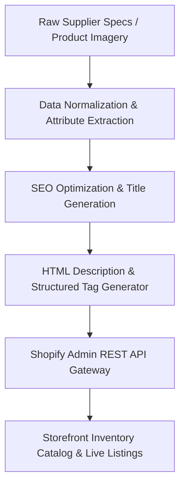

<div align="center">

<h1>Shopify Catalog Automation & Listing Optimization</h1>


<p><strong>Automated E-Commerce Product Catalog Ingestion, SEO Enrichment, and Storefront Sync</strong></p>

<p>
  <a href="https://skillicons.dev"></a>
</p>

</div>

---

## Executive Summary

The Shopify Catalog Automation platform streamlines e-commerce inventory publishing. From supplier specifications or raw imagery, the pipeline generates SEO-optimized product titles, descriptions, tag hierarchies, and variant pricing schemas, publishing directly to Shopify storefronts through authenticated Admin REST APIs.

---

## Platform Interface & Listing Gallery

<table align="center">
  <tr>
    <td align="center"><b>Product Ingestion & Title Optimization</b><br><sub>Raw product specification ingestion and SEO title generation.</sub></td>
    <td align="center"><b>Attribute Extraction & Taxonomy Mapping</b><br><sub>Automated category mapping and variant property extraction.</sub></td>
  </tr>
  <tr>
    <td align="center"></td>
    <td align="center"></td>
  </tr>
  <tr>
    <td align="center" colspan="2"><b>Shopify Storefront Synchronization Dashboard</b><br><sub>Direct API synchronization with live storefront inventory catalogs.</sub></td>
  </tr>
  <tr>
    <td align="center" colspan="2"></td>
  </tr>
</table>

---

## System Architecture



---

## Technology Stack

| Layer | Technologies |
| :--- | :--- |
| Frontend | React, Vite, Tailwind CSS |
| Backend API | Python, FastAPI, Requests |
| Storefront Integration | Shopify Admin REST API |

---

## Installation & Setup

```bash
# Clone the repository
git clone https://github.com/sohailahmed-bsrh/shopify-listing.git
cd shopify-listing

# Configure backend
cd backend
pip install -r requirements.txt
python main.py

# Configure frontend
cd ../frontend
npm install
npm run dev
```

---

## Author & License

- **Author**: Sohail Ahmed ([Portfolio](https://sohail.devsil.com) | [GitHub](https://github.com/sohailahmed-bsrh))
- **License**: Distributed under the MIT License.
