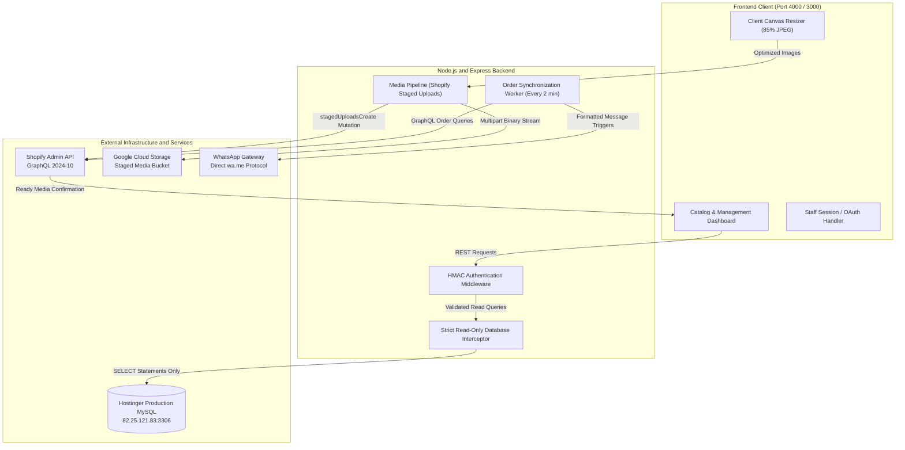

<div align="center">

  # EMS Shopify Listing and Store Automation

  **Enterprise Multi-Channel Shopify Integration, Live MySQL Sync, WhatsApp Engagement, and Audit Logging**

  <p>
    A production-grade full-stack solution bridging the live Hostinger EMS MySQL database with the Shopify GraphQL Admin API.<br />
    Enables automated product publishing, real-time catalog synchronization, multi-source image optimization, bi-directional order tracking, and immutable activity auditing.
  </p>

  <p>
    <a href="https://github.com/sohail-ahmed-26">GitHub Profile</a> &bull;
    <a href="https://sohail.devsil.com">Portfolio Website</a> &bull;
    <a href="https://www.linkedin.com/in/sohail-ahmed-devsil">LinkedIn</a> &bull;
    <a href="mailto:sohail.bsrh@gmail.com">Email Contact</a>
  </p>

</div>

---

## Technical Specifications

| Parameter | Specification |
| :--- | :--- |
| **System Architecture** | Two-tier Monorepo: Modular Node.js / Express REST API + Modern React 19 Frontend |
| **Production Database** | Live Hostinger MySQL (`82.25.121.83:3306`) with Query Guard & Connection Isolation |
| **E-Commerce Protocol** | Shopify GraphQL Admin API (`2024-10`) with OAuth 2.0 & Staged Uploads |
| **Media Staging** | Client-side Canvas Image Compression + Google Cloud Storage Multipart Uploads |
| **Order Automation** | Incremental 2-Minute Polling Worker + Direct WhatsApp Protocol (`wa.me`) |
| **Compliance & Auditing** | Tamper-proof JSON Event Log with Staff Email Attribution |

---

## Application Interface

### Primary Interface: Product Catalog and Listing Studio

<div align="center">
  
  <p><em>Figure 1: Full-width overview of the catalog monitoring interface, featuring real-time Active and Draft state tracking, instant search filtering, storefront reachability verification, and direct deep-linking to Shopify Admin.</em></p>
</div>

<br />

### Secondary Interfaces: Orders Synchronization and Activity Audit

<div align="center">
  <table width="100%" style="border-collapse: collapse; border: none;">
    <thead>
      <tr>
        <th width="50%" align="center">Shopify Orders Synchronization</th>
        <th width="50%" align="center">Audit Records and Activity History</th>
      </tr>
    </thead>
    <tbody>
      <tr>
        <td width="50%" align="center" valign="top">
          
        </td>
        <td width="50%" align="center" valign="top">
          
        </td>
      </tr>
      <tr>
        <td width="50%" align="center" valign="top">
          <em>Figure 2: Incremental order ingestion dashboard with financial indicators, payment and fulfillment filters, and direct WhatsApp customer communication shortcuts.</em>
        </td>
        <td width="50%" align="center" valign="top">
          <em>Figure 3: Tamper-proof audit logging capturing product creation, EMS imports, price edits, status updates, and deletions by staff members.</em>
        </td>
      </tr>
    </tbody>
  </table>
</div>

---

## Table of Contents

- [Overview](#overview)
- [Problem Statement and Solution](#problem-statement-and-solution)
- [Core Features](#core-features)
- [System Architecture and Data Flow](#system-architecture-and-data-flow)
- [Technology Stack](#technology-stack)
- [Project Structure](#project-structure)
- [Configuration and Environment Variables](#configuration-and-environment-variables)
- [Installation and Setup](#installation-and-setup)
- [Verification and Testing](#verification-and-testing)
- [Security Guarantees](#security-guarantees)
- [Author and Contact Information](#author-and-contact-information)
- [License](#license)

---

## Overview

EMS Shopify Listing and Store Automation is an enterprise-grade full-stack application developed for the E-Commerce Management System (EMS) and Devsil ecosystem.

Managing large-scale product catalogs across separate enterprise resource planning (ERP) databases and hosted e-commerce channels like Shopify often suffers from slow manual data exports, schema discrepancies, restricted media upload pipelines, and fragmented order tracking workflows.

This application connects directly to the production Hostinger EMS MySQL database and the Shopify GraphQL Admin API (2024-10). It provides staff members with a unified operational console to browse warehouse inventory, customize listings, execute staged media uploads via Google Cloud Storage, synchronize incoming orders, and initiate direct customer communication through WhatsApp.

---

## Problem Statement and Solution

| Operational Challenge | Technical Solution Implemented |
| :--- | :--- |
| **Manual Data Re-Entry** | Direct connection to the live MySQL database (`82.25.121.83:3306`) with dynamic schema resolution, extracting titles, pricing, descriptions, categories, and inventory counts. |
| **Shopify Trial URL Restrictions** | Implementation of `mediaPipeline.js`, utilizing Shopify's `stagedUploadsCreate` GraphQL API and direct multipart uploads to Google Cloud Storage (GCS) to bypass trial account URL limitations. |
| **Accidental Production Mutations** | Strict read-only query guard (`emsQuery`) at the database connection pool layer, permanently rejecting any non-`SELECT` SQL operation. |
| **Delayed Customer Order Support** | Background worker syncing orders incrementally every 2 minutes with automated generation of pre-filled `wa.me` customer communication links. |
| **Unmonitored Catalog Modifications** | Comprehensive JSON audit store (`backend/data/records.json`) capturing every status change, price edit, import, and deletion with associated staff identifiers. |

---

## Core Features

### 1. Staff Shopify Authentication and Session Security
- **OAuth 2.0 Admin API Handshake**: Complete authentication flow with HMAC signature verification, cryptographically random `state` parameters, and nonces.
- **Staff Email Validation**: Optional allowlist check against configured `ALLOWED_EMAILS` prior to granting dashboard access.
- **Signed Session Cookies**: Tamper-proof 7-day session cookies (`ems_session`) signed using SHA-256 HMAC tokens.

### 2. Strictly Read-Only Database Layer
- **Live Hostinger MySQL Pool**: Direct connection targeting `82.25.121.83:3306` with connection isolation (maximum 3 pool connections) and 10-second query timeouts.
- **SQL Query Guard**: Enforces allowlist validation permitting only `SELECT`, `SHOW`, `DESCRIBE`, and `EXPLAIN` statements. Any attempt to execute `INSERT`, `UPDATE`, `DROP`, or `DELETE` throws an immediate exception.
- **Sanitized Errors**: Internal database credentials and hostnames are stripped from API error responses before reaching clients.

### 3. Multi-Source Image Processing Pipeline
- **Input Channels**: Accepts local file selection, drag-and-drop, and clipboard image pasting (`Ctrl+V`).
- **Client-Side Optimization**: Built-in HTML5 Canvas optimizer automatically resizes assets up to 2000px at 85% JPEG quality to reduce payload sizes and upload latency.
- **Staged Uploads Execution**: Requests signed upload credentials via Shopify's `stagedUploadsCreate` mutation and streams multipart payloads directly to Google Cloud Storage.
- **Asynchronous Polling**: Background poller queries media ingestion status until reaching `READY` state before completing product creation.

### 4. Catalog Management and In-App Preview Studio
- **Status Lifecycle Control**: Single-click toggling between `ACTIVE` and `DRAFT` status with automatic Online Store sales channel publication.
- **In-App Preview Drawer**: Slide-over preview drawer equipped with hero image zoom, selectable thumbnail galleries, and allowlist-sanitized HTML descriptions.
- **Storefront Reachability Checker**: Real-time link verification detecting online store availability and development password protection.

### 5. Order Synchronization and Customer Engagement
- **Incremental Order Polling**: Scheduled background service synchronizing newly placed Shopify orders every 2 minutes.
- **Structured Data Persistence**: Cached local JSON storage preserving order identifiers, financial summaries, line items, and fulfillment states.
- **WhatsApp Integration**: Single-click generator creating structured `wa.me/<phone>?text=...` links containing customer names, order IDs, and total amounts.

### 6. Audit Trail and Activity Logging
- Persistent tracking stored in `backend/data/records.json`.
- Logs timestamped entries for `created`, `edited`, `listed_from_ems`, `status_changed`, and `deleted` actions along with user identity.

---

## System Architecture and Data Flow



---

## Technology Stack

| Architecture Layer | Component | Specification |
| :--- | :--- | :--- |
| **Backend Runtime** | Node.js | Version 18.0.0 or higher (ES Modules) |
| **Web Server Framework** | Express.js | REST API routing, JSON body parsers, cookie middleware |
| **Primary Frontend** | React 19, Vite, TypeScript | Modern single-page client located in `frontend/` |
| **CSS Framework** | Tailwind CSS v4 | High-performance styling engine |
| **Standalone Portal** | Vanilla HTML5 / CSS3 / ES6 | Self-contained lightweight portal in `backend/standalone/` |
| **Database Connector** | MySQL 8.x (`mysql2/promise`) | Connection pooling, isolated read-only query transactions |
| **E-Commerce API** | Shopify GraphQL Admin API | Version `2024-10` |
| **Media Staging Storage** | Google Cloud Storage (GCS) | Shopify-managed bucket via `stagedUploadsCreate` |
| **Local Persistence** | JSON File Stores | Persistent files in `backend/data/` |
| **Session Security** | Node.js Crypto | SHA-256 HMAC tokens, HttpOnly cookies |

---

## Project Structure

The project maintains a clean two-folder organization separating the backend API environment from the frontend client:

```text
shopify_listing/
├── README.md                         # Main project documentation
├── .gitignore                        # Git ignore patterns
│
├── backend/                          # Backend API & Server Environment
│   ├── .env                          # Local environment credentials
│   ├── .env.example                  # Environment configuration template
│   ├── package.json                  # Backend dependencies and scripts
│   ├── ngrok.exe                     # Development tunneling binary
│   │
│   ├── src/                          # Modular Express Application
│   │   ├── config/db.js              # MySQL connection pool configuration
│   │   ├── controllers/              # Shopify, product, media, and listing controllers
│   │   ├── routes/                   # Express route definitions
│   │   ├── services/                 # Shopify GraphQL, S3, Gemini, Whisper services
│   │   └── index.js                  # Main server entry point (Port 4000)
│   │
│   ├── standalone/                   # Standalone Express Server & Portal
│   │   ├── server.js                 # Standalone application entry
│   │   ├── auth.js                   # OAuth handshake and session validation
│   │   ├── ems.js                    # Read-only database query execution
│   │   ├── shopify.js                # Shopify GraphQL query wrappers
│   │   ├── mediaPipeline.js          # Staged upload media pipeline
│   │   ├── linksStore.js             # EMS-to-Shopify ID mapping store
│   │   ├── ordersStore.js            # Order synchronization and WhatsApp store
│   │   ├── records.js                # Audit logging engine
│   │   └── public/                   # Static dashboard assets (index.html, login.html)
│   │
│   ├── public/                       # Compiled production build from frontend/
│   │   ├── index.html                # Compiled client HTML
│   │   └── assets/                   # Bundled CSS and JavaScript chunks
│   │
│   ├── data/                         # Local persistent JSON datastores
│   │   ├── links.json                # EMS-to-Shopify product mappings
│   │   ├── orders.json               # Synchronized Shopify orders cache
│   │   └── records.json              # Staff activity audit entries
│   │
│   ├── scripts/                      # Verification and test suites
│   │   ├── smoke.js                  # End-to-end smoke tests
│   │   ├── test-endpoints.js         # API endpoint test runner
│   │   ├── test-staged.js            # Staged upload verification
│   │   └── verify_all.cjs            # Full system verification script
│   │
│   └── uploads/                      # Temporary storage for local media assets
│
└── frontend/                         # Modern React 19 + TypeScript + Vite Client
    ├── package.json                  # Frontend dependencies and build commands
    ├── vite.config.ts                # Vite build and proxy configuration
    ├── tsconfig.json                 # TypeScript compiler configuration
    ├── index.html                    # Single-page client template
    │
    ├── screenshots/                  # User interface documentation images
    │   ├── 1.png                     # Primary catalog showcase image
    │   ├── 2.png                     # Orders sync view image
    │   └── 3.png                     # Audit records view image
    │
    └── src/                          # Client Source Code
        ├── components/               # Navbar, Sidebar, EMSProductsView, EMSOrdersView
        ├── data/                     # Mock fixtures and catalog constants
        ├── services/api.ts           # REST API client
        ├── types/                    # TypeScript interfaces
        └── App.tsx                   # Root React component
```

---

## Configuration and Environment Variables

Configuration parameters are managed through `backend/.env`:

```env
# Shopify Store & API Configuration
SHOP=devsil-store.myshopify.com
CLIENT_ID=your_shopify_app_client_id
CLIENT_SECRET=your_shopify_app_client_secret
API_VERSION=2024-10
PORT=4000
BASE_URL=http://localhost:4000

# Session Security
SESSION_SECRET=your_super_secret_64_character_hex_key
ALLOWED_EMAILS=staff@devsil.com,admin@devsil.com

# Production Hostinger EMS MySQL Database
EMS_DB_HOST=82.25.121.83
EMS_DB_PORT=3306
EMS_DB_USER=your_mysql_user
EMS_DB_PASSWORD=your_mysql_password
EMS_DB_NAME=your_database_name
EMS_PRODUCTS_TABLE=products
```

---

## Installation and Setup

### Prerequisites
- Node.js 18.0.0 or higher
- npm or pnpm
- Valid Shopify Development Store or Partner account
- Network access to the Hostinger database (`82.25.121.83:3306`)

### 1. Clone the Repository
```bash
git clone https://github.com/sohail-ahmed-26/shopify_listing.git
cd shopify_listing
```

### 2. Configure Environment
```bash
cp backend/.env.example backend/.env
# Update backend/.env with your verified Shopify and MySQL credentials
```

### 3. Install Dependencies
```bash
# Install backend packages
cd backend
npm install

# Install frontend packages
cd ../frontend
npm install
```

### 4. Build and Run

#### Running the Production Backend (Serves API and Built Client)
```bash
# Compile latest React client bundle
cd frontend
npm run build

# Start backend server
cd ../backend
npm start
```

* **Application Portal:** [http://localhost:4000](http://localhost:4000)
* **Health Endpoint:** [http://localhost:4000/api/health](http://localhost:4000/api/health)

#### Running Frontend in Vite Development Mode
```bash
cd frontend
npm run dev
```

* **Vite Development Server:** [http://localhost:3000](http://localhost:3000) (requests to `/api` proxy automatically to port 4000)

---

## Verification and Testing

Automated verification suites are located in `backend/scripts/`:

```bash
cd backend

# Execute end-to-end smoke test suite
node scripts/smoke.js

# Test API endpoints and responses
node scripts/test-endpoints.js

# Verify staged upload pipeline functionality
node scripts/test-staged.js

# Run comprehensive integrity verification
node scripts/verify_all.cjs
```

---

## Security Guarantees

- **Credential Redaction**: Sensitive values such as API client secrets, database passwords, and session tokens are permanently masked in all log outputs (`[REDACTED]`).
- **Database Read-Only Enforcement**: Query protection operates through AST and regex keyword filtering in `ems.js`, rejecting any data mutation attempt prior to query dispatch.
- **Server-Side Request Forgery (SSRF) Prevention**: URL resolution logic verifies external target addresses and blocks requests directing to internal or private subnets (`127.0.0.1`, `10.0.0.0/8`, `172.16.0.0/12`, `192.168.0.0/16`).
- **HTML Sanitization**: All product description rendering is processed against strict tag allowlists (`p, br, b, strong, i, em, ul, ol, li, h2, h3, a[rel=noopener]`) to eliminate Cross-Site Scripting (XSS) risks.

---

## Author and Contact Information

<div align="center">
  <a href="https://github.com/sohail-ahmed-26">
    
  </a>
  <h3>Sohail Ahmed</h3>
  <p>AI Engineer & Data Scientist | Full Stack AI Developer</p>
  <p>Devsil (SMC-Private) Limited</p>
</div>

<br/>

| Channel | Contact & Link |
| :--- | :--- |
| **Portfolio Website** | [sohail.devsil.com](https://sohail.devsil.com) |
| **LinkedIn** | [linkedin.com/in/sohail-ahmed-devsil](https://www.linkedin.com/in/sohail-ahmed-devsil) |
| **GitHub** | [github.com/sohail-ahmed-26](https://github.com/sohail-ahmed-26) |
| **Email** | [sohail.bsrh@gmail.com](mailto:sohail.bsrh@gmail.com) / [ahmed241126@gmail.com](mailto:ahmed241126@gmail.com) |
| **Kaggle** | [kaggle.com/sohail2411126](https://www.kaggle.com/sohail2411126) |
| **Twitter / X** | [x.com/ahmed241126](https://x.com/ahmed241126) |
| **Location** | Mansehra, Pakistan |

---

## License

This software is developed and maintained by [Sohail Ahmed](https://github.com/sohail-ahmed-26) at **Devsil (SMC-Private) Limited**. All rights reserved.
