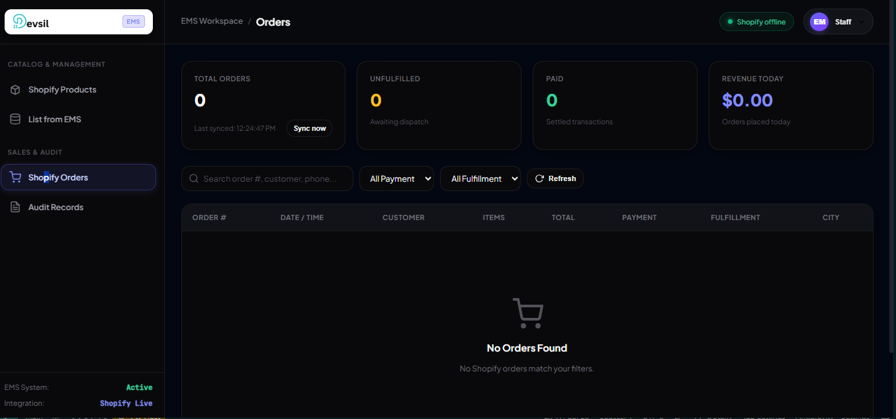
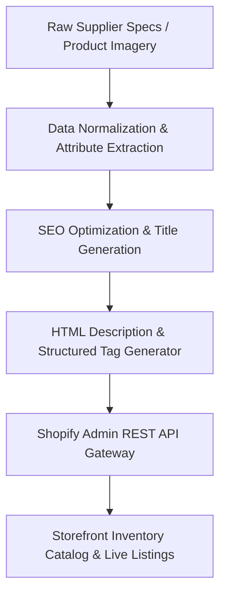

<div align="center">

<h1>Shopify Catalog Automation & Listing Optimization</h1>


<p><strong>Automated E-Commerce Product Catalog Ingestion, SEO Enrichment, and Storefront Sync</strong></p>

<p>
  <a href="https://skillicons.dev"></a>
</p>

<p>
  <a href="#overview">Overview</a> &bull;
  <a href="#system-architecture">Architecture</a> &bull;
  <a href="#visual-showcase-gallery">Visual Gallery</a> &bull;
  <a href="#core-capabilities">Capabilities</a> &bull;
  <a href="#installation--setup">Installation</a> &bull;
  <a href="#author--contact-information">Author</a>
</p>

</div>

---
## Overview

The Shopify Catalog Automation platform streamlines e-commerce inventory publishing. From supplier specifications or raw imagery, the pipeline generates SEO-optimized product titles, descriptions, tag hierarchies, and variant pricing schemas, publishing directly to Shopify storefronts through authenticated Admin REST APIs.

---

## Visual Showcase Gallery

<table width="100%" align="center">
  <tr>
    <td width="50%" align="center"><b>Product Ingestion & Title Optimization</b><br><sub>Raw product specification ingestion and SEO title generation.</sub></td>
    <td width="50%" align="center"><b>Attribute Extraction & Taxonomy Mapping</b><br><sub>Automated category mapping and variant property extraction.</sub></td>
  </tr>
  <tr>
    <td align="center"></td>
    <td align="center"></td>
  </tr>
  <tr>
    <td colspan="2" align="center"><b>Shopify Storefront Synchronization Dashboard</b><br><sub>Direct API synchronization with live storefront inventory catalogs.</sub></td>
  </tr>
  <tr>
    <td colspan="2" align="center"></td>
  </tr>
</table>

---

## System Architecture



---

## Technology Stack

| Layer | Technologies |
| :--- | :--- |
| Frontend | React, Vite, Tailwind CSS |
| Backend API | Python, FastAPI, Requests |
| Storefront Integration | Shopify Admin REST API |

---

## Installation & Setup

```bash
# Clone the repository
git clone https://github.com/sohailahmed-bsrh/shopify-listing.git
cd shopify-listing

# Configure backend
cd backend
pip install -r requirements.txt
python main.py

# Configure frontend
cd ../frontend
npm install
npm run dev
```
---

## Author & Contact Information

<table width="100%" align="center">
  <tr>
    <td align="center" style="padding: 20px;">
      <h3>Sohail Ahmed</h3>
      <p><strong>Full-Stack Artificial Intelligence & Computer Vision Engineer</strong></p>
      <p>
        <a href="https://sohail.devsil.com"></a>
        <a href="https://github.com/sohailahmed-bsrh"></a>
        <a href="https://linkedin.com/in/sohail-ahmed-dev"></a>
        <a href="mailto:sohail.bsrh@gmail.com"></a>
      </p>
      <p><em>Available for technical roles in Artificial Intelligence, Computer Vision, and Full-Stack Engineering.</em></p>
      <hr style="border: 0; height: 1px; background: #30363d; margin: 15px 0;">
      <small>Repository: <code>sohailahmed-bsrh/shopify-listing</code> &bull; Distributed under the MIT License.</small>
    </td>
  </tr>
</table>
