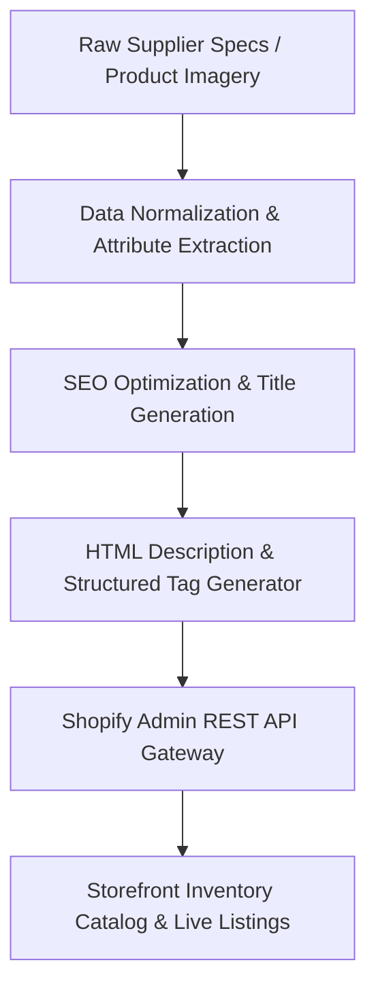
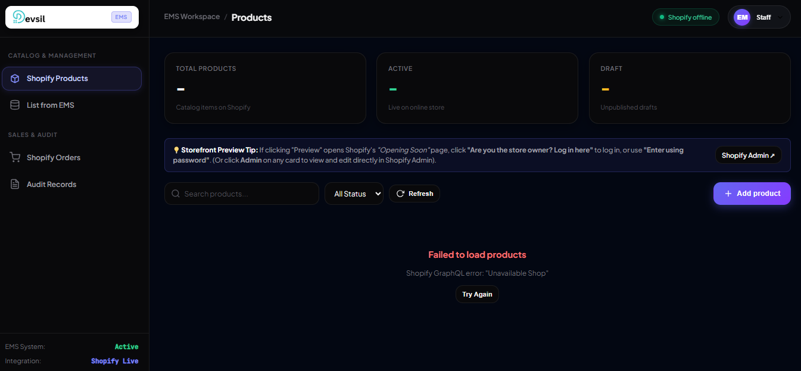
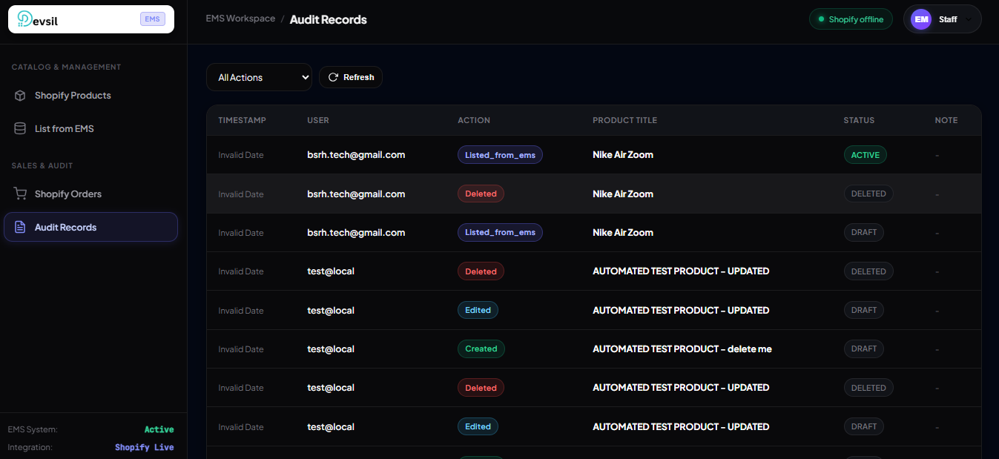

<div align="center">

<h1>Shopify Catalog Automation & Listing Optimization</h1>


<p><strong>Automated E-Commerce Product Catalog Ingestion, SEO Enrichment, and Storefront Sync</strong></p>

<p>
  <a href="https://skillicons.dev"></a>
</p>

<p>
  <a href="#overview">Overview</a> &bull;
  <a href="#purpose--problem-statement">Purpose</a> &bull;
  <a href="#real-world-industry-applications">Use Cases</a> &bull;
  <a href="#step-by-step-engineering-walkthrough">How It Was Built</a> &bull;
  <a href="#system-architecture">Architecture</a> &bull;
  <a href="#visual-showcase-gallery">Visual Gallery</a> &bull;
  <a href="#technology-stack-matrix">Tech Stack</a> &bull;
  <a href="#installation--setup">Installation</a> &bull;
  <a href="#author--contact-information">Author</a>
</p>

</div>

---
## Overview

The Shopify Catalog Automation platform streamlines e-commerce inventory publishing. From supplier specifications or raw product photos, the pipeline generates SEO-optimized product titles, conversion-focused descriptions, taxonomy categories, and variant pricing schemas, publishing directly to Shopify storefronts through authenticated Admin REST APIs.

---

## Purpose & Problem Statement

### The Problem
E-commerce merchants managing hundreds or thousands of SKUs spend an enormous amount of time manually creating product listings: copying supplier sheets, writing keyword-rich descriptions, uploading images, configuring inventory variants (sizes, colors, pricing), and tagging categories. Manual entry introduces typographical errors, inconsistent branding, and slow time-to-market.

### The Engineering Purpose
To build an automated catalog pipeline that ingests raw supplier data, extracts technical product specifications, synthesizes conversion-focused SEO product listings, and programmatically publishes live products to Shopify storefronts via the official Shopify Admin REST API.

---

## Real-World Industry Applications

- **Multi-Brand E-Commerce Retailers**: Bulk uploading seasonal inventory catalogs from overseas supplier manifests into Shopify in minutes.
- **Dropshipping & Direct-to-Consumer Brands**: Rapidly publishing and testing new trending consumer products with SEO-optimized copy.
- **Wholesale-to-Retail Migration**: Digitizing traditional wholesale product books into modern searchable e-commerce storefronts.
- **Digital Marketing Agencies**: Managing catalog publishing workflows across multiple client Shopify stores.

---

## Step-by-Step Engineering Walkthrough (How It Was Built)

### Step 1: Supplier Data Ingestion & Media Upload
The ingestion module (`backend/src/controllers/productController.js`) accepts supplier CSV manifests, JSON feeds, or individual product images. Images are uploaded to object storage (`backend/src/config/s3.js`) and tagged with unique asset IDs.

### Step 2: Algorithmic SEO Enrichment & Copywriting
The AI controller (`backend/src/controllers/aiController.js`) processes the raw specs:
- Generates search-optimized, click-worthy product titles.
- Formulates benefit-driven HTML descriptions highlighting key features, technical dimensions, and warranty details.
- Extracts standardized taxonomy tags and Google Product Categories.

### Step 3: Variant Configuration & Pricing Logic
The listing controller (`backend/src/controllers/listingController.js`) parses variant attributes (Sizes, Colors, Materials) and calculates profit margins based on wholesale cost, domestic shipping overhead, and target gross margin thresholds.

### Step 4: Shopify Admin REST API Gateway
The Shopify integration service (`backend/src/controllers/shopifyController.js`) constructs authenticated payloads matching the official Shopify Product API schema:
- `POST /admin/api/2024-01/products.json`
It manages API rate limits (leaky bucket algorithm), uploads image asset URLs, assigns inventory tracker IDs, and returns live store product URLs.

### Step 5: Dashboard Management & Storefront Sync
The React interface displays active synchronization statuses, product review queues, and live inventory counts, alerting merchants to any schema validation errors before publishing.

---

## System Architecture



---

## Visual Showcase Gallery

<table width="100%" align="center">
  <tr>
    <td width="50%" align="center"><b>Product Ingestion & Title Optimization</b><br><sub>Raw product specification ingestion and SEO title generation.</sub></td>
    <td width="50%" align="center"><b>Attribute Extraction & Taxonomy Mapping</b><br><sub>Automated category mapping and variant property extraction.</sub></td>
  </tr>
  <tr>
    <td align="center"></td>
    <td align="center"></td>
  </tr>
  <tr>
    <td colspan="2" align="center"><b>Shopify Storefront Synchronization Dashboard</b><br><sub>Direct API synchronization with live storefront inventory catalogs.</sub></td>
  </tr>
  <tr>
    <td colspan="2" align="center"></td>
  </tr>
</table>

---

## Technology Stack Matrix

| Layer | Technologies | Version / Role | Engineering Purpose |
| :--- | :--- | :--- | :--- |
| Backend Server | Node.js, Express | 20.x / 4.19+ | REST API gateway, listing controller, and background sync worker |
| Storefront Integration | Shopify Admin REST API | 2024-01 | Authenticated inventory, product, and media asset management |
| Cloud Storage | AWS S3 / Cloudflare R2 | Latest | CDN hosting for high-resolution product imagery |
| Frontend UI | React, Vite, Tailwind CSS | 18.2 / 5.0+ | Merchant review portal, product editor, and sync status console |

---

## Installation & Setup

```bash
# Clone the repository
git clone https://github.com/sohailahmed-bsrh/shopify-listing.git
cd shopify-listing

# Configure backend
cd backend
npm install
npm start

# Configure frontend in another terminal
cd ../frontend
npm install
npm run dev
```
---

## Author & Contact Information

<table width="100%" align="center">
  <tr>
    <td align="center" style="padding: 20px;">
      <h3>Sohail Ahmed</h3>
      <p><strong>Full-Stack Artificial Intelligence & Computer Vision Engineer</strong></p>
      <p>
        <a href="https://sohail.devsil.com"></a>
        <a href="https://github.com/sohailahmed-bsrh"></a>
        <a href="https://linkedin.com/in/sohail-ahmed-dev"></a>
        <a href="mailto:sohail.bsrh@gmail.com"></a>
      </p>
      <p><em>Available for technical roles in Artificial Intelligence, Computer Vision, and Full-Stack Engineering.</em></p>
      <hr style="border: 0; height: 1px; background: #30363d; margin: 15px 0;">
      <small>Repository: <code>sohailahmed-bsrh/shopify-listing</code> &bull; Distributed under the MIT License.</small>
    </td>
  </tr>
</table>
