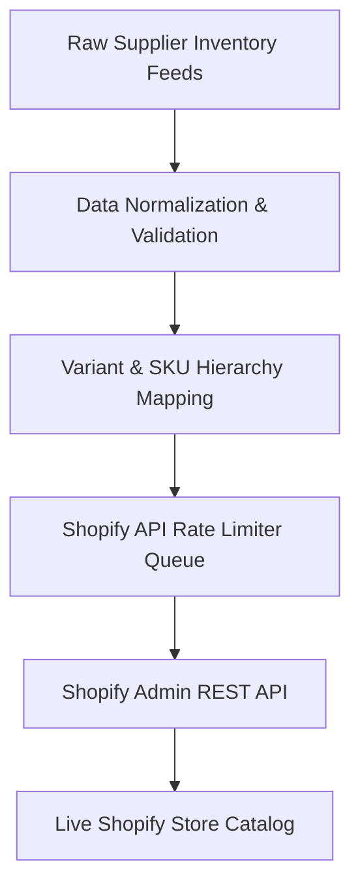

# Shopify Product Catalog Automation Suite

> E-commerce operational suite automating supplier feed validation and Shopify Admin REST API uploads.

[](https://github.com/sohailahmed-bsrh/shopify-listing)
[](https://sohail.devsil.com/projects.html)
[](https://sohail.devsil.com)

---

## Overview

Manual product uploads to Shopify stores introduce pricing inconsistencies, inventory errors, and consume hundreds of operational hours.

This project provides an end-to-end, reproducible implementation engineered to solve this challenge through verified data transformations, robust algorithms, and production-ready architecture.

---

## Key Features

- Bulk supplier inventory file ingestion supporting CSV, Excel, and JSON formats
- Product data normalization, variant structuring, and category tax mapping
- Rate-limited batch publishing via Shopify Admin REST API
- Standalone Node.js backend with web status monitor

---

## System Architecture



---

## Technology Stack

| Technology | Version / Spec | Role in Architecture |
| :--- | :--- | :--- |
| **Node.js & Express** | `18+` | API client, CSV stream parser, and batch worker |
| **Shopify Admin REST API** | `2024-01+` | Product, variant, and media asset mutation endpoints |
| **HTML5 / CSS3** | `Modern` | Operational dashboard for job dispatching |

---

## Repository Structure

```text
shopify-listing/
|-- backend/
|   |-- standalone/
|   |   |-- package.json
|   |   `-- server.js
|   |-- src/
|   |-- .env.example
|   `-- package.json
|-- .gitignore
`-- README.md
```

---

## Installation and Execution

### Prerequisites
- Python 3.10 or higher
- Git version control
- Virtual environment manager (`venv`)

### Setup Instructions
1. Clone the repository:
```bash
git clone https://github.com/sohailahmed-bsrh/shopify-listing.git
cd shopify-listing
```

2. Configure environment and dependencies:
```bash
cd backend/standalone
npm install
cp ../.env.example .env
node server.js
```

---

## Interface and Verification
The system produces verifiable execution logs, prediction matrices, or interactive browser interfaces depending on the target mode. Verify operation by executing the commands specified above or inspecting the demonstration notebooks.

---

## Author and Contact
Developed by **Sohail Ahmed** — Full Stack AI Engineer & Machine Learning Specialist.
- **Portfolio:** [sohail.devsil.com](https://sohail.devsil.com)
- **GitHub:** [@sohailahmed-bsrh](https://github.com/sohailahmed-bsrh)
- **Email:** [sohail.bsrh@gmail.com](mailto:sohail.bsrh@gmail.com)
